# Payflow · Documento de apresentação

Este documento explica o Payflow de ponta a ponta: o problema que ele resolve, o que ele faz, as linguagens e tecnologias usadas, como o código está organizado, o banco de dados, as regras de cálculo da folha, a segurança, os testes e o processo de desenvolvimento. No fim há um roteiro para a demonstração ao vivo e respostas para as perguntas mais prováveis.

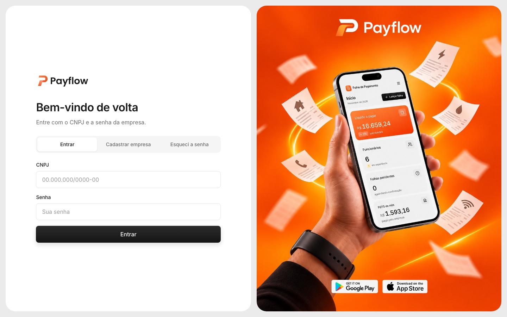

## Sumário

1. [Visão geral](#1-visão-geral)
2. [O que o sistema faz](#2-o-que-o-sistema-faz)
3. [Linguagens e tecnologias](#3-linguagens-e-tecnologias)
4. [Arquitetura](#4-arquitetura)
5. [Banco de dados](#5-banco-de-dados)
6. [Regras de negócio e cálculos](#6-regras-de-negócio-e-cálculos)
7. [A API](#7-a-api)
8. [As telas](#8-as-telas)
9. [Design system e identidade visual](#9-design-system-e-identidade-visual)
10. [Segurança](#10-segurança)
11. [Qualidade e testes](#11-qualidade-e-testes)
12. [Processo de desenvolvimento](#12-processo-de-desenvolvimento)
13. [Como rodar](#13-como-rodar)
14. [Roteiro da apresentação](#14-roteiro-da-apresentação)
15. [Perguntas prováveis](#15-perguntas-prováveis)
16. [Limitações e próximos passos](#16-limitações-e-próximos-passos)

---

## 1. Visão geral

**O problema.** Muitas pequenas empresas ainda calculam a folha de pagamento à mão ou em planilhas. Isso gera erros nos descontos de INSS e IRRF, benefícios descontados acima do que a lei permite e nenhum histórico confiável do que foi pago.

**A solução.** O Payflow é um sistema de folha de pagamento que:
- cadastra a empresa e os funcionários;
- calcula a folha de cada mês automaticamente, com as regras de 2026 (INSS progressivo, IRRF com a nova faixa de isenção e FGTS);
- considera horas extras, faltas e atrasos;
- controla os benefícios e impede descontos acima do limite;
- guarda o histórico de todas as folhas, com holerite para imprimir.

**ODS.** O projeto se relaciona ao ODS 8 da ONU (Trabalho Decente e Crescimento Econômico): pagamento correto e transparente para o trabalhador.

**Duas formas de usar.** O sistema tem um **menu no console** (a versão original, em Java) e uma **versão web** que roda no navegador. As duas usam o mesmo banco de dados e o mesmo código de cálculo, então sempre chegam no mesmo valor.

**Em números:**

| Parte | Tamanho |
|---|---|
| Código Java | 26 classes, cerca de 3.400 linhas |
| Telas (HTML, CSS e JavaScript) | 8 páginas, cerca de 2.300 linhas |
| Banco de dados | 10 tabelas, script SQL com cerca de 240 registros de exemplo |
| API | 24 rotas |
| Testes automatizados | 89 testes em Java (JUnit) e 3 em JavaScript |

## 2. O que o sistema faz

| Área | O que dá para fazer |
|---|---|
| Acesso | Entrar com CNPJ e senha (3 tentativas), cadastrar a empresa e redefinir a senha |
| Início | Ver o líquido do mês, funcionários, folhas pendentes, FGTS, gráfico dos últimos 6 meses e as folhas do mês |
| Funcionários | Listar, buscar, filtrar por período de experiência, cadastrar, editar todos os dados, ver a ficha e excluir |
| Lançar folha | Escolher o funcionário, informar horas extras, faltas e atrasos e ver o holerite calculado na hora |
| Folhas pendentes | Conferir, confirmar ou apagar as folhas lançadas |
| Histórico | Ver as folhas por mês (com totais) ou por funcionário e imprimir o holerite |
| Benefícios | Dar, editar e remover benefícios, com o limite de desconto mostrado na hora |

A folha passa por dois estados: ela é **lançada como pendente** e só depois é **confirmada**. Enquanto está pendente, pode ser apagada; depois de confirmada, não.

## 3. Linguagens e tecnologias

| Tecnologia | Para que foi usada | Por que essa escolha |
|---|---|---|
| **Java 21** | Regras de negócio, cálculo da folha, acesso ao banco, servidor web e menu no console | Linguagem da disciplina; o back-end original já era em Java |
| **SQL (SQLite)** | Banco de dados | Banco em um único arquivo, sem instalar servidor; ótimo para projeto acadêmico |
| **JDBC + sqlite-jdbc** | Ligação do Java com o SQLite | Padrão do Java para bancos relacionais |
| **HttpServer do JDK** | Servidor web da versão no navegador | Já vem no Java; não precisa de framework nem de biblioteca extra |
| **HTML** | Estrutura das telas | Base de qualquer página web |
| **CSS** | Visual: cores, tamanhos, fontes, animações e layout para celular | Sem framework, para mostrar o design system feito à mão |
| **JavaScript** | Interação: chamadas à API, máscaras, formulários, gráficos e modais | Puro (módulos ES), sem framework e sem etapa de build |
| **JSON** | Formato das respostas da API | Leitura direta no JavaScript |
| **JUnit 5** | Testes automatizados do Java | Padrão de testes em Java |
| **Node.js (`node:test`)** | Testes das funções de formatação do front | Roda JavaScript fora do navegador |
| **Git e GitHub** | Controle de versão, com Git Flow | Histórico de cada mudança e trabalho em grupo |
| **Eclipse** | IDE usada pelo grupo | Já era a ferramenta do projeto |

Divisão entre front-end e back-end:
- **Front-end** (o que o usuário vê): HTML, CSS e JavaScript, na pasta `web/`.
- **Back-end** (o que processa as informações): Java, na pasta `src/`, e o banco SQLite, na pasta `database/`.

## 4. Arquitetura

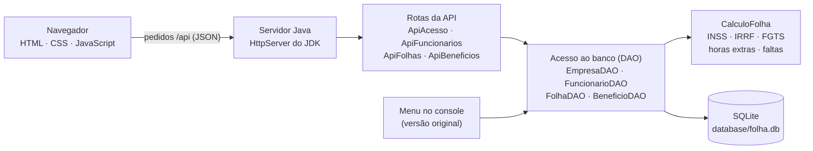

**Como um pedido funciona.** Quando o usuário clica em "Lançar como pendente":
1. o JavaScript da tela envia os dados para a rota `POST /api/folhas`;
2. o `Roteador` confere se a pessoa está logada e chama a rota certa;
3. a rota usa o `FolhaDAO`, que busca o salário e os benefícios no banco e pede ao `CalculoFolha` o holerite;
4. o `FolhaDAO` grava a folha e cada linha do holerite numa transação (ou grava tudo, ou nada);
5. a resposta volta em JSON, e a tela mostra o holerite.

**Uma regra importante do projeto:** todas as contas são feitas **só no Java**. O JavaScript apenas mostra o que a API devolve. Por isso o console e o navegador nunca dão valores diferentes.

**Organização das pastas:**

```
payflow/
├── src/Folha_Pagamentos/   código Java
│   ├── folha.java              início do menu no console
│   ├── Servidor.java           início da versão web
│   ├── Roteador.java           recebe os pedidos /api e chama a rota certa
│   ├── Api*.java               rotas da API (acesso, funcionários, folhas, benefícios)
│   ├── *DAO.java               consultas ao banco de dados
│   ├── CalculoFolha.java       cálculo do holerite
│   ├── descontos.java          tabelas de INSS e IRRF
│   └── (demais)                menus do console, validações, senha, JSON, sessões
├── web/                    telas (front-end)
│   ├── *.html                  uma página por tela
│   ├── css/                    design system (ds.css) e layout (layout.css)
│   ├── js/                     funções comuns e um arquivo por tela
│   ├── fonts/                  fonte Inter (funciona sem internet)
│   └── img/                    logo Payflow e imagem da tela de login
├── database/folha2.db.sql  script do banco (tabelas e dados de exemplo)
├── test/                   testes automatizados (JUnit e Node)
└── docs/img/               prints usados neste documento
```

## 5. Banco de dados

### Modelo

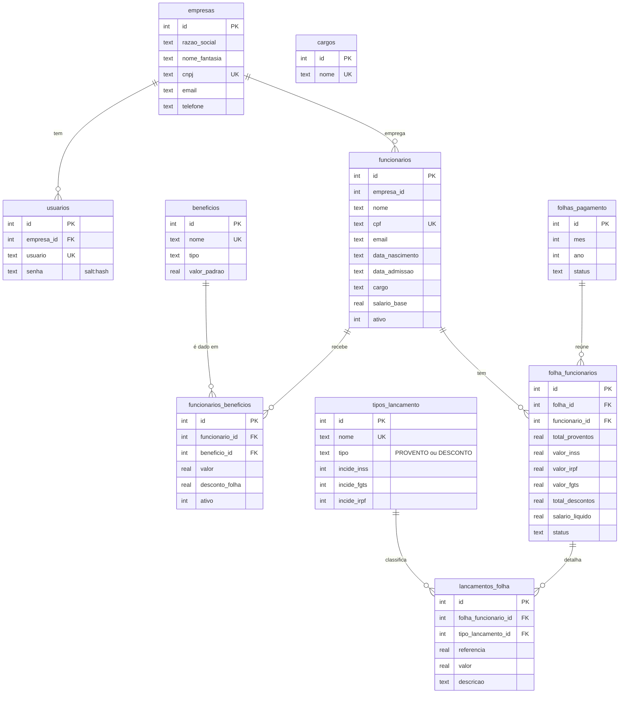

### Para que serve cada tabela

| Tabela | Guarda |
|---|---|
| `empresas` | As empresas que usam o sistema |
| `usuarios` | O login de cada empresa (a senha fica com hash) |
| `funcionarios` | Os funcionários de cada empresa (`ativo = 0` quando foi desligado) |
| `cargos` | Sugestões de cargo para o cadastro |
| `beneficios` | O catálogo: vale-transporte, refeição, alimentação, planos e vale-combustível |
| `funcionarios_beneficios` | Qual funcionário recebe qual benefício, o valor e quanto é descontado na folha |
| `folhas_pagamento` | A competência (mês e ano) |
| `folha_funcionarios` | A folha de cada funcionário em cada mês, com todos os totais |
| `lancamentos_folha` | Cada linha do holerite (salário, horas extras, falta, INSS, IRRF, benefícios) |
| `tipos_lancamento` | Os tipos de linha e se cada um entra na base do INSS, FGTS e IRRF |

### Integridade dos dados
- **Chaves primárias** com autoincremento em todas as tabelas.
- **Chaves estrangeiras** ligando folhas, lançamentos, benefícios e usuários.
- **Valores únicos:** CNPJ, CPF, nome do benefício e nome do tipo de lançamento.
- **Índice único** `(folha_id, funcionario_id)`: um funcionário não pode ter duas folhas no mesmo mês.
- **Índice único** `(funcionario_id, beneficio_id, ativo)`: o mesmo benefício não pode estar ativo duas vezes para a mesma pessoa.

### Decisões de modelagem que valem comentar
- **A folha guarda os totais já calculados** (INSS, IRRF, líquido). Isso é uma repetição de dados de propósito: o holerite fica "congelado" como foi pago, mesmo que o salário ou um benefício mude depois.
- **Cada linha do holerite vira um registro** em `lancamentos_folha`, ligado ao seu tipo. Assim o histórico mostra exatamente o que foi pago e descontado.
- **Funcionário desligado não é apagado** se já tiver folha; ele só fica inativo, para o histórico continuar correto.

### Consultas com JOIN usadas pelo sistema
Folhas pendentes de uma empresa:

```sql
SELECT ff.id, fp.mes, fp.ano, fu.id AS funcionario_id, fu.nome, fu.cargo, ff.salario_liquido
FROM folha_funcionarios ff
JOIN folhas_pagamento fp ON fp.id = ff.folha_id
JOIN funcionarios fu ON fu.id = ff.funcionario_id
WHERE fu.empresa_id = ? AND ff.status = 'PENDENTE'
ORDER BY fp.ano, fp.mes, fu.nome;
```

Linhas do holerite, com o nome de cada tipo (proventos primeiro):

```sql
SELECT lf.tipo_lancamento_id, lf.descricao, lf.referencia, lf.valor, tl.nome, tl.tipo
FROM lancamentos_folha lf
JOIN tipos_lancamento tl ON tl.id = lf.tipo_lancamento_id
WHERE lf.folha_funcionario_id = ?
ORDER BY (tl.tipo = 'DESCONTO'), lf.id;
```

O `?` é preenchido pelo Java com `PreparedStatement`, o que impede SQL injection.

### Dados de exemplo
O script `database/folha2.db.sql` cria as tabelas e carrega:
- a empresa **Administracao de Facilities** (CNPJ 12.345.678/0001-99, senha `123456`);
- 6 funcionários, um deles ainda em experiência;
- benefícios variados;
- folhas de **junho a novembro de 2026**, calculadas pelo próprio sistema. Em novembro, todos têm folha menos o **João da Silva**, que fica livre para a demonstração, e duas folhas estão pendentes.

## 6. Regras de negócio e cálculos

### INSS (progressivo, 2026)
Cada parte do salário paga a alíquota da sua faixa:

| Faixa do salário | Alíquota |
|---|---|
| até R$ 1.621,00 | 7,5% |
| de R$ 1.621,01 a R$ 2.902,84 | 9% |
| de R$ 2.902,85 a R$ 4.354,27 | 12% |
| de R$ 4.354,28 a R$ 8.475,55 | 14% |

### IRRF (2026)
1. Base = salário − o maior entre o INSS e o desconto simplificado (R$ 607,20).
2. Aplica a tabela: isento até R$ 2.428,80; 7,5%, 15%, 22,5% e 27,5% nas faixas seguintes, com a parcela a deduzir.
3. Regra nova de 2026: quem ganha **até R$ 5.000,00 não paga IRRF**; entre R$ 5.000,00 e R$ 7.350,00 há uma redução (R$ 978,62 − 0,133145 × salário).

### FGTS
8% da base, **pago pela empresa** (não é descontado do funcionário).

### Horas extras, faltas e atrasos
| Item | Fórmula |
|---|---|
| Valor da hora | salário ÷ 220 |
| Hora extra 50% | hora × 1,5 × horas |
| Hora extra 100% | hora × 2 × horas |
| Falta | salário ÷ 30 × dias |
| Atraso | hora × horas |

Faltas e atrasos diminuem a base do INSS, do IRRF e do FGTS. Limites para evitar erro de digitação: até 30 dias de falta e até 220 horas de atraso ou de horas extras.

### Benefícios
| Benefício | Desconto máximo na folha |
|---|---|
| Vale-transporte | 6% do salário (e nunca mais que o valor do vale) |
| Vale-refeição e vale-alimentação | 20% do valor do benefício |
| Demais (planos, vale-combustível) | 10% do salário |

O sistema recusa qualquer percentual acima do limite, tanto na tela quanto na API.

### Outras regras
- **Experiência:** os 3 primeiros meses após a admissão.
- **Uma folha por funcionário por mês.**
- **CPF válido** (com dígito verificador) e único; e-mail no formato certo.
- **Folha pendente** pode ser apagada; **confirmada**, não.

### Exemplo completo: João da Silva
Salário de R$ 2.500,00 e benefícios com desconto de R$ 300,00 (VT R$ 150, VR R$ 50, plano R$ 100).

| | Valor |
|---|---|
| INSS: 1.621,00 × 7,5% + 879,00 × 9% | R$ 200,69 |
| IRRF (ganha menos de R$ 5.000) | R$ 0,00 |
| Benefícios | R$ 300,00 |
| **Salário líquido** | **R$ 1.999,31** |
| FGTS (pago pela empresa) | R$ 200,00 |

Com **10 horas extras a 50%**: hora = R$ 11,36; horas extras = R$ 170,45; INSS = R$ 216,03; **líquido = R$ 2.154,42**.

Com **1 falta**: desconto de R$ 83,33; INSS = R$ 193,19; **líquido = R$ 1.923,48**.

### Exemplo com IRRF: Carlos Souza
Salário de R$ 6.200,00: INSS R$ 669,51; IRRF R$ 459,03 (já com a redução de 2026). Sem benefícios, o líquido seria R$ 5.071,46. Com o plano de saúde (R$ 120,00), fica **R$ 4.951,46**, que é o valor mostrado no sistema.

Todos esses valores estão conferidos por testes automatizados (ver a seção 11).

## 7. A API

O navegador conversa com o Java por estas rotas. Todas, menos as de acesso, exigem login e só enxergam os dados da empresa logada.

| Método | Rota | Faz |
|---|---|---|
| POST | `/api/acesso/entrar` | Login |
| POST | `/api/acesso/cadastrar` | Cadastra empresa |
| POST | `/api/acesso/redefinir` | Redefine a senha |
| POST | `/api/acesso/sair` | Sai |
| GET | `/api/acesso/eu` | Dados da empresa logada |
| GET | `/api/resumo` | Números do Início e do gráfico |
| GET | `/api/funcionarios` | Lista (com busca e filtro) |
| GET | `/api/funcionarios/{id}` | Ficha |
| POST | `/api/funcionarios` | Cadastra |
| PUT | `/api/funcionarios/{id}` | Edita |
| DELETE | `/api/funcionarios/{id}` | Exclui ou desliga |
| GET | `/api/cargos` | Sugestões de cargo |
| POST | `/api/folhas/simular` | Calcula sem gravar (prévia) |
| POST | `/api/folhas` | Lança a folha (pendente) |
| GET | `/api/folhas` | Pendentes, histórico do mês ou do funcionário |
| GET | `/api/folhas/{id}` | Holerite |
| POST | `/api/folhas/{id}/confirmar` | Confirma |
| DELETE | `/api/folhas/{id}` | Apaga (só pendente) |
| GET | `/api/beneficios` | Catálogo de benefícios |
| GET | `/api/beneficios/limite` | Limite de desconto de um benefício |
| GET | `/api/funcionarios/{id}/beneficios` | Benefícios do funcionário |
| POST | `/api/funcionarios/{id}/beneficios` | Dá um benefício |
| PUT | `/api/funcionarios-beneficios/{id}` | Edita |
| DELETE | `/api/funcionarios-beneficios/{id}` | Remove |

Os erros voltam com o código HTTP certo (400 dado inválido, 401 sem login, 404 não encontrado, 409 conflito, 429 muitas tentativas) e com o nome do campo errado, para a tela marcar o campo.

## 8. As telas

### Login
CNPJ com máscara e senha. Depois de 3 senhas erradas, aquele CNPJ fica bloqueado por 5 minutos. Também tem cadastro de empresa e "esqueci a senha". (Imagem no topo deste documento.)

### Início
Os cartões mostram o líquido do mês (com a variação em relação ao mês anterior), os funcionários, as folhas pendentes e o FGTS. O gráfico dos últimos 6 meses tem duas opções:
- **Barras:** líquido e descontos empilhados, em reais.
- **Linhas:** quanto cada um variou desde junho (junho = 100%), para comparar a tendência dos dois na mesma escala. Ao passar o mouse, aparecem a porcentagem e o valor em reais.

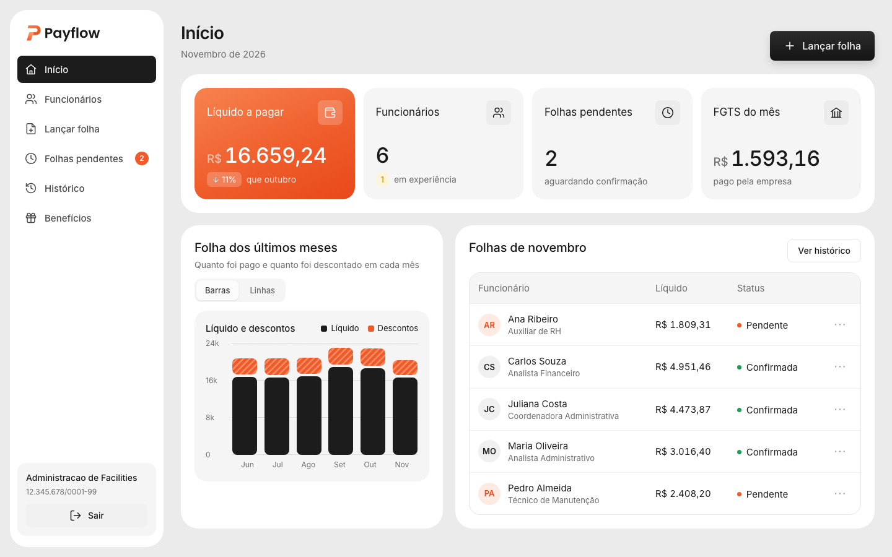

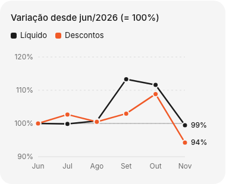

### Funcionários
Lista com busca, filtro (todos, em experiência, efetivados), tempo de empresa e situação.

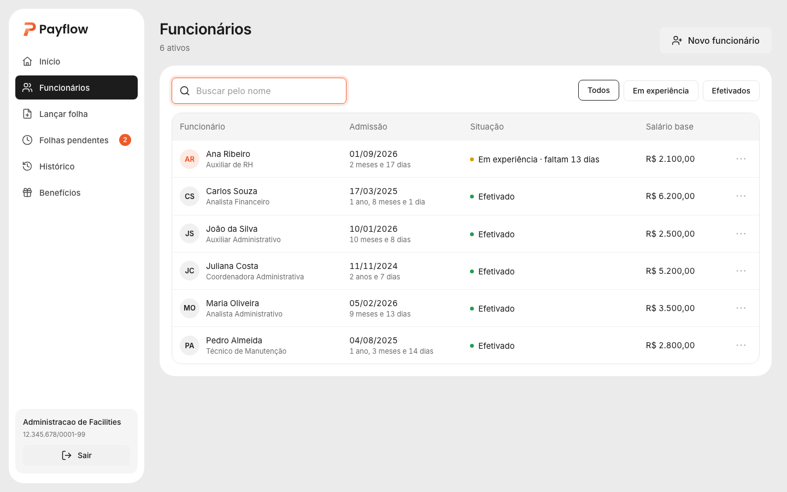

O cadastro confere o CPF pelo dígito verificador e mostra o erro no próprio campo:

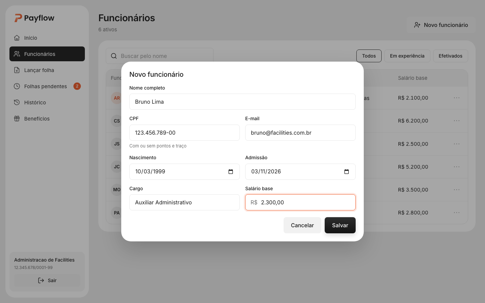

A ficha mostra os dados, os benefícios e o histórico de folhas:

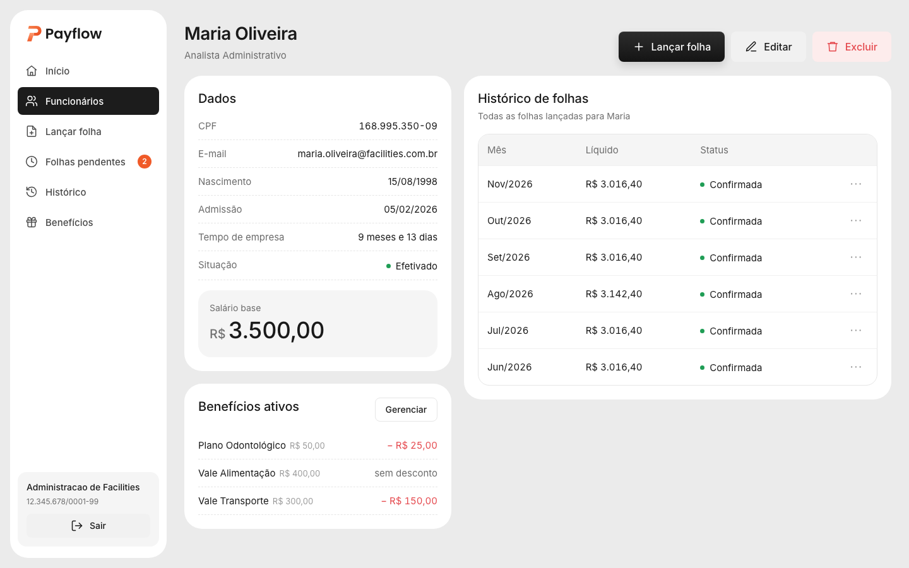

### Lançar folha
A tela principal da demonstração: a prévia do holerite muda enquanto se digita as horas extras, faltas e atrasos.

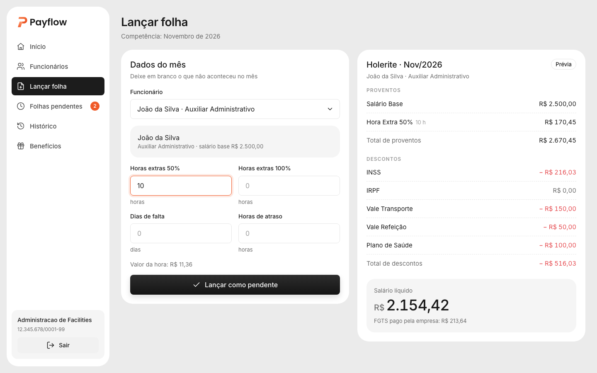

### Folhas pendentes e histórico
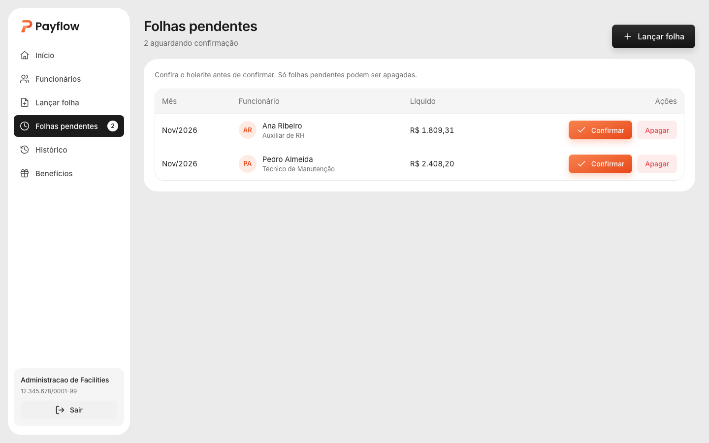

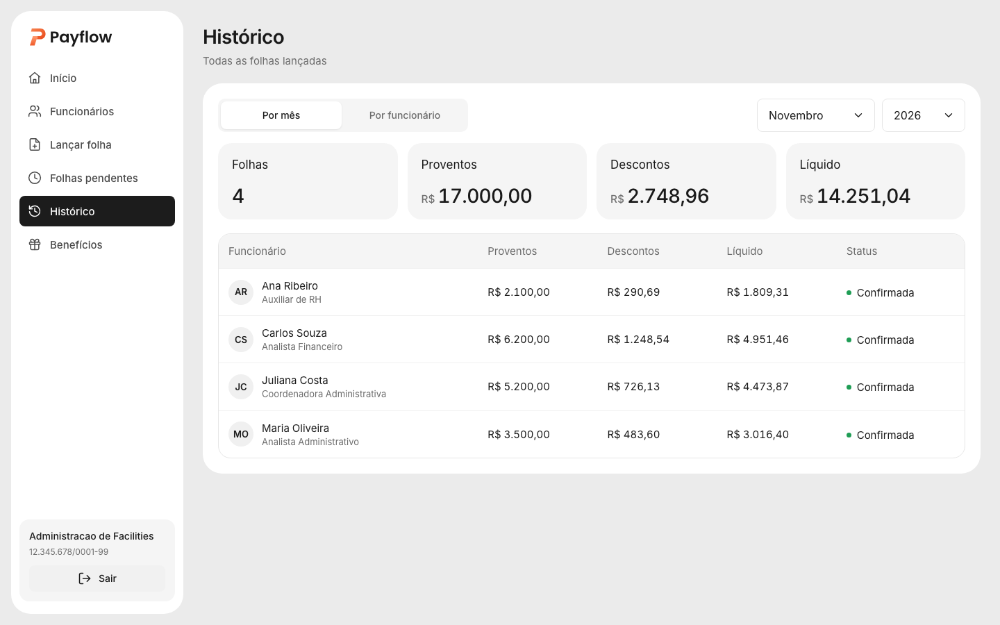

O holerite pode ser impresso direto pelo navegador; na impressão só ele aparece:

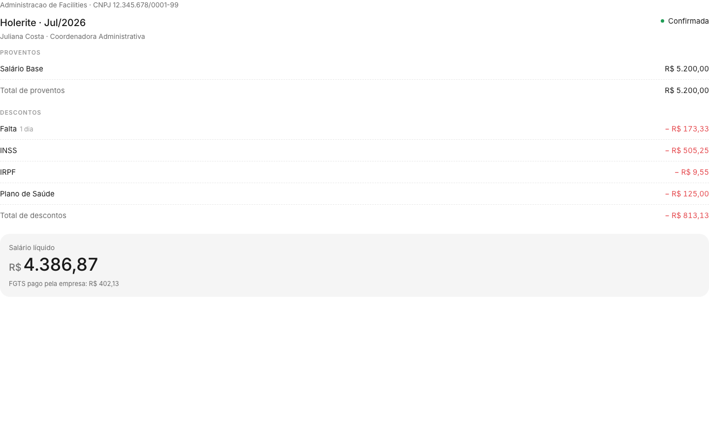

### Benefícios
A barra mostra quanto do limite está sendo usado, calculado pelo Java na hora.

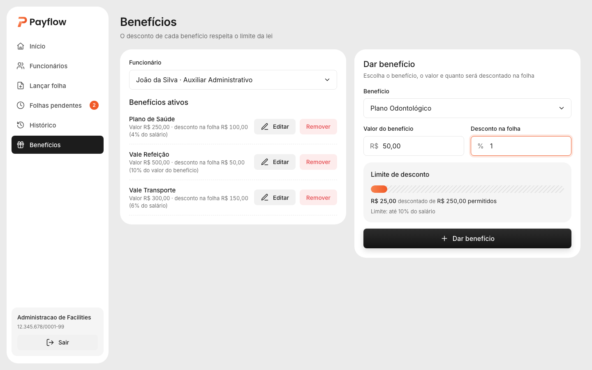

### No celular
O layout se adapta: o menu vira uma gaveta.

| Início | Menu |
|---|---|
| 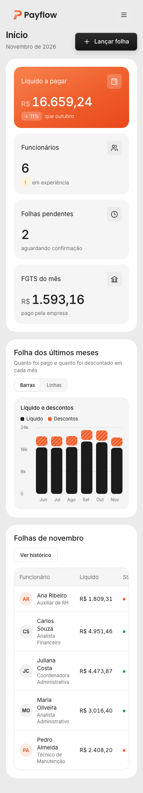 | 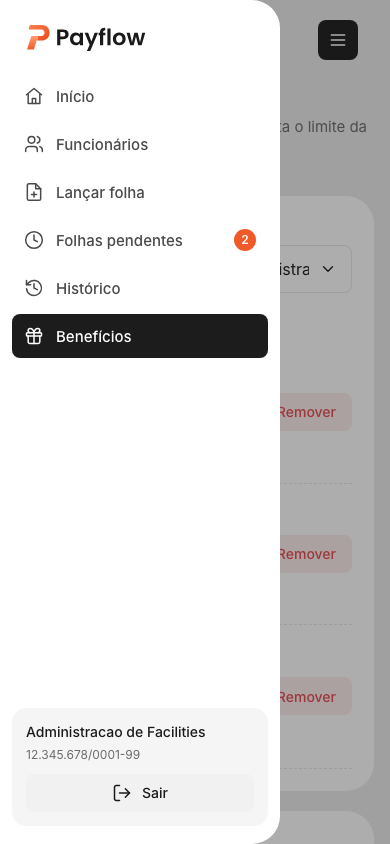 |

## 9. Design system e identidade visual

Antes das telas, foi criado e aprovado um **design system**, com base numa referência visual de dashboard financeiro.

| Elemento | Definição |
|---|---|
| Cores | Fundo `#EBEBEB`, cartões brancos, laranja da marca `#F05A28` (com degradê), preto `#1C1C1C` nos botões principais |
| Status | Verde = confirmada, laranja = pendente, amarelo = em experiência, vermelho = descontos e erros |
| Fonte | Inter (400, 500 e 600), salva no projeto para funcionar sem internet |
| Formas | Painéis com canto de 28px; botões e campos quase quadrados, com canto de 8px |
| Botões | Os principais têm um brilho diagonal ao passar o mouse; os demais mudam de cor ou de borda |
| Acessibilidade | Contorno laranja no foco por teclado; o brilho é desligado para quem reduz animações no sistema |

**Logo.** A marca Payflow foi recriada em SVG: um "P" inclinado com degradê laranja e a palavra em Poppins SemiBold convertida em contornos, para aparecer igual em qualquer computador. Há três versões em `web/img/`: para fundo claro, branca e só o símbolo (usado no ícone da aba).

## 10. Segurança

| Cuidado | Como foi feito |
|---|---|
| Senha | Nunca é guardada em texto: vira hash SHA-256 com um "sal" aleatório de 16 bytes |
| Tentativas de login | 3 erros bloqueiam aquele CNPJ por 5 minutos |
| Sessão | Código aleatório de 32 bytes num cookie `HttpOnly` (o JavaScript não consegue ler) |
| Dados de outra empresa | Toda consulta filtra pela empresa logada; pedir o id de outra empresa responde "não encontrado" |
| SQL injection | Consultas com `PreparedStatement` |
| Código malicioso em nomes (XSS) | As telas escapam todo texto antes de mostrar |
| Arquivos do servidor | O servidor só entrega arquivos de dentro da pasta `web/` |
| Rede | O servidor só aceita conexões do próprio computador (127.0.0.1) |

## 11. Qualidade e testes

**Testes automatizados no repositório:**
- **89 testes em Java (JUnit 5)**, em 11 classes, cobrindo:
  - o cálculo (João, Maria, Carlos, horas extras, faltas, atrasos);
  - o banco e os dados de exemplo;
  - o console;
  - cada rota da API, inclusive login, bloqueio e isolamento entre empresas;
  - limites de benefício.
- **3 testes em JavaScript** das funções de formatação (moeda, datas, CPF, CNPJ e números digitados do jeito brasileiro).

**Testes no navegador.** Durante o desenvolvimento, cada tela também foi testada automaticamente num Chrome de verdade (Playwright): login, cadastro, lançamento, confirmação, impressão, benefícios e layout de celular. Esses testes ficaram fora do repositório porque dependem de ferramentas instaladas na máquina de desenvolvimento.

**Como foi o processo (TDD).** Para cada funcionalidade, o teste foi escrito antes do código, rodado para ver falhar e só então o código foi feito até o teste passar.

**Defeitos que os testes e a revisão encontraram** (bons exemplos de garantia de qualidade):

| Defeito | Como apareceu | Correção |
|---|---|---|
| Testes falhavam 2 ou 3 vezes em 60 rodadas | Investigação: outro programa do computador usava a mesma porta em 127.0.0.1 e recebia os pedidos | Servidor passou a abrir só em 127.0.0.1; 0 falhas em 60 rodadas |
| Desconto de R$ 100,08 num vale de R$ 100 | Revisão de código: arredondamento do percentual máximo | Máximo arredondado para baixo e desconto limitado ao valor |
| Salário "3.500" virava R$ 3,50 | Revisão de código | Ponto de milhar reconhecido |
| 45 faltas geravam líquido negativo | Revisão de código | Limite de 30 dias e base nunca negativa |
| Console fechava ao remover um benefício já removido pela web | Revisão de código | Console passou a usar a mesma regra da web |

Cada correção ganhou um teste que falhava antes e passa depois.

## 12. Processo de desenvolvimento

**Etapas:**
1. Levantamento: leitura da atividade e do back-end em Java que o grupo já tinha.
2. Design system: a partir de uma referência visual, aprovado tela a tela antes de qualquer código.
3. Documento de design: o que construir, o que não construir e as regras.
4. Plano em 16 etapas, cada uma com seus testes.
5. Implementação com TDD.
6. Revisão de código independente da branch inteira, seguida das correções.

**Git Flow:**
- `main`: versões entregues;
- `develop`: integração;
- uma branch por funcionalidade (`feature/...`, `fix/...`, `docs/...`), juntada à `develop` por merge.

**Commits semânticos:** `feat:` para funcionalidade, `fix:` para correção, `docs:` para documentação, `style:` para ajustes visuais.

**Ferramentas de apoio.** A versão web contou com o Claude, assistente de IA da Anthropic, como par de programação. Os commits feitos com ele trazem a linha `Co-Authored-By`.

## 13. Como rodar

**Precisa de:**
- JDK 21;
- o arquivo `sqlite-jdbc-3.53.4.0.jar` (Maven Central);
- um navegador.

**1. Baixar o projeto**
```bash
git clone https://github.com/venikzada/payflow.git
cd payflow
```

**2. Criar o banco** a partir do script, com o DB Browser for SQLite (*Arquivo → Importar → Banco de dados a partir de arquivo SQL*, salvando como `database/folha.db`) ou pelo terminal:
```bash
sqlite3 database/folha.db < database/folha2.db.sql
```

**3a. Pelo Eclipse**
1. *File → Import → Existing Projects into Workspace*.
2. Em *Build Path*, aponte o `sqlite-jdbc` para o jar no seu computador. O `.classpath` traz o caminho do Windows de um integrante.
3. Rode a classe `Folha_Pagamentos.Servidor`.

**3b. Ou pelo terminal** (no Windows, troque `:` por `;`):
```bash
javac -d out src/Folha_Pagamentos/*.java
java -cp "out:sqlite-jdbc-3.53.4.0.jar" Folha_Pagamentos.Servidor
```

**4.** Abra `http://localhost:8080` e entre com o CNPJ `12.345.678/0001-99` e a senha `123456`.

**Menu no console:** rode a classe `Folha_Pagamentos.folha` (mesmo banco e mesmo login).

**Rodar os testes** (na pasta do projeto, com o `junit-platform-console-standalone-1.11.4.jar`):
```bash
javac -d out src/Folha_Pagamentos/*.java
javac -cp "out:junit-platform-console-standalone-1.11.4.jar" -d out-test test/Folha_Pagamentos/*.java
java -jar junit-platform-console-standalone-1.11.4.jar execute --class-path "out:out-test:sqlite-jdbc-3.53.4.0.jar" --scan-class-path out-test
node --test test/web/*.test.mjs
```

## 14. Roteiro da apresentação

**Antes de começar:**
- Recrie o banco a partir do script (passo 2). Isso deixa o João sem folha em novembro, pronto para o lançamento ao vivo.
- Deixe o servidor rodando e o navegador aberto no login.
- Os dados de exemplo vão até novembro de 2026, e o Início sempre mostra o mês atual. Se a apresentação for em outro mês, lance algumas folhas antes para o Início não aparecer vazio.

**Demonstração (cerca de 10 minutos):**

| Tempo | Mostrar | Falar |
|---|---|---|
| 1 min | Slide ou README | O problema das planilhas e o objetivo do Payflow |
| 1 min | **Login** com uma senha errada e depois a certa | Senha com hash e bloqueio depois de 3 tentativas |
| 1 min | **Início**, trocando o gráfico de Barras para Linhas | Resumo do mês; o gráfico de linhas compara a variação do líquido e dos descontos |
| 2 min | **Funcionários**: filtro "Em experiência" e cadastro com CPF errado e depois certo | Validação do CPF pelo dígito verificador |
| 2 min | **Lançar folha** do João: sem extras (R$ 1.999,31), com 10 h extras (R$ 2.154,42), com 1 falta (R$ 1.923,48) e lançar | O cálculo é feito no Java na hora: INSS por faixas, IRRF 2026 e FGTS |
| 1 min | **Folhas pendentes**: confirmar | Pendente pode ser apagada; confirmada, não |
| 1 min | **Histórico**: abrir um holerite e imprimir | Histórico confiável de tudo que foi pago |
| 1 min | **Benefícios**: tentar 11% num plano odontológico | O sistema recusa desconto acima do limite da lei |
| opcional | Menu no console | O console dá o mesmo líquido, porque usa o mesmo cálculo |
| opcional | Testes rodando | 89 testes passando |

## 15. Perguntas prováveis

**Por que Java sem framework (como Spring)?**
O servidor que já vem no JDK basta para o tamanho do projeto e deixa visível como um servidor web funciona: rotas, cookies e JSON, tudo feito à mão.

**Por que SQLite?**
É um banco relacional completo (SQL, chaves e índices) em um único arquivo, sem instalar servidor. Para trocar por MySQL ou PostgreSQL, mudariam basicamente a conexão e alguns tipos.

**Onde o cálculo é feito?**
Só no Java, na classe `CalculoFolha`. A tela apenas exibe. Assim a regra fica em um lugar só, e o console e a web dão o mesmo valor.

**Como a senha é guardada?**
Como `sal:hash`: o sal são 16 bytes aleatórios e o hash é SHA-256 do sal mais a senha. Nem quem abre o banco descobre a senha.

**Como uma empresa não vê os dados de outra?**
A sessão guarda a empresa logada, e todas as consultas filtram por ela. Existe teste automatizado que tenta acessar dados de outra empresa e confere que a resposta é "não encontrado".

**O banco está normalizado?**
Em sua maior parte, sim. Há duas decisões conscientes:
- a folha guarda os totais calculados, para o holerite ficar congelado como foi pago;
- o cargo é guardado como texto, herdado do sistema original, e a tabela `cargos` serve como lista de sugestões.

Um próximo passo seria ligar o cargo por chave estrangeira.

**O que acontece se excluir um funcionário que já recebeu?**
Ele é desligado (fica inativo) em vez de apagado, para o histórico continuar correto. Quem nunca teve folha é apagado de vez.

**Por que o gráfico de linhas está em porcentagem?**
O líquido (perto de R$ 16 mil) e os descontos (perto de R$ 3 mil) têm tamanhos muito diferentes. Em reais, a linha dos descontos ficaria achatada. Mostrando a variação desde junho, as duas ficam na mesma escala e dá para comparar a tendência. Os valores em reais aparecem ao passar o mouse.

**O sistema tem aplicativo para celular?**
Não. Ele é web e se adapta à tela do celular. Os selos de lojas de aplicativo na imagem da tela de login são só ilustração.

**Como sabem que os cálculos estão certos?**
Os valores foram conferidos à mão e travados em testes automatizados. Se alguém alterar o cálculo sem querer, o teste falha.

## 16. Limitações e próximos passos

- Não calcula férias, 13º salário, rescisão nem DSR sobre faltas.
- A folha é sempre lançada no mês atual.
- Um usuário por empresa, sem níveis de permissão.
- Um funcionário desligado não pode ser recontratado com o mesmo CPF.
- O servidor roda só no próprio computador; para usar em rede ou na internet, seriam necessários HTTPS e hospedagem.
- Próximos passos possíveis: exportar o holerite em PDF, relatórios anuais e o envio do holerite por e-mail.
